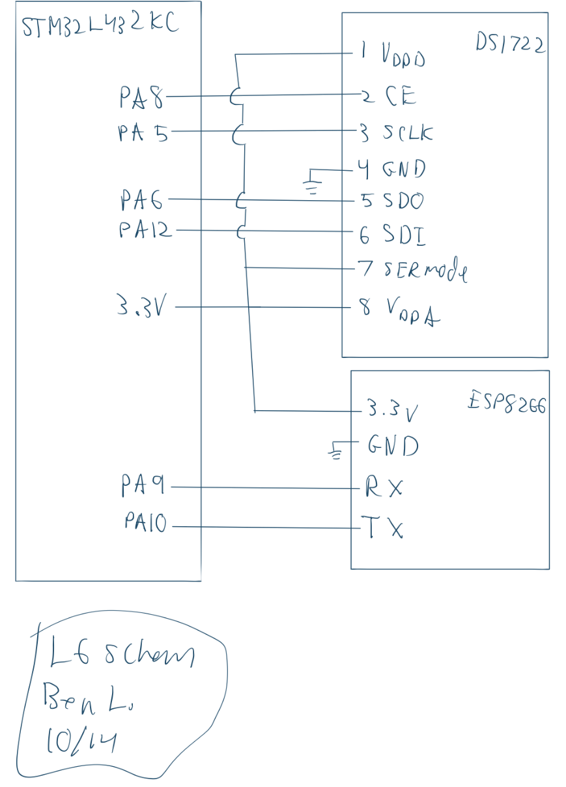
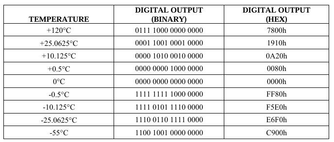
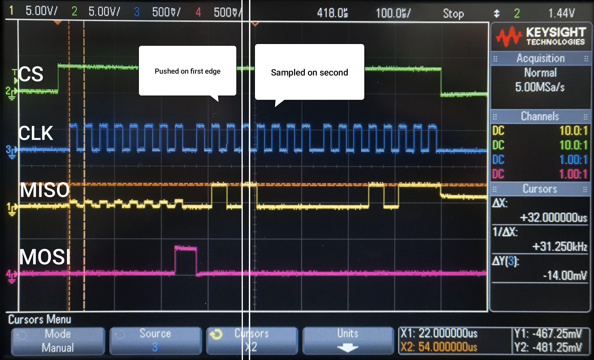
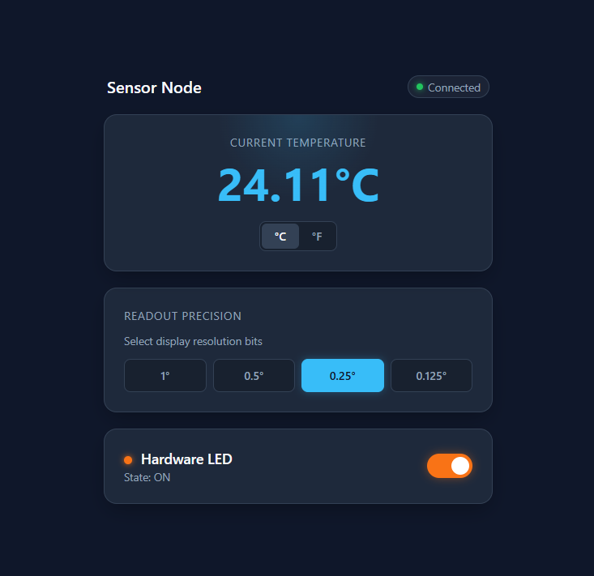

## Introduction
In this lab, I implemented a SPI communication library to interface with a DS1722 temperature sensor. To display the temperature and set the resolution of the sensor I hosted an html page with an ESP8266 module.

## Design and Testing Methodology
The SPI setup was dependent on having all the configuration bits set correctly. You also need to make sure that the GPIO pins you are using are set to the corect mode and routed to the SPI peripheral. In the process of sending and receiving data, you just neeed to wait until the respective TX and RX buffers are empy/full before writing/reading the shift register. 

A program was already flashed to the ESP8266 module that hosted a an html page constructeed from strings sent over the UART. The html was modified on the MCU to display ther temperature, and form responses were sent back to the MCU to set the resolution of the sensor.

## Technical Documentation
The source code and all figures for the project can be found in the associated [Github repository](https://github.com/Jebeandiah/e155lab6/tree/main)

### Schematic
::: {.callout-note collapse="true"}
## Expand to see schematic

:::

### Calculations
::: {.callout-note collapse="true"}
## Expand to see calculations

Raw temperature conversion: Based on the followeing table from the datasheet, the temperature is encoded as a sort of fixed-point value in two's complement:

To determine the scalar to produce a decimal point in the proper place:

$$k = \frac{1}{2^8} = \frac{1}{256} $$

:::
## Results and Discussion

::: {.callout-note collapse="true"}
## Expand to see SPI traces
Traces of a multi-byte burst read at addresses 1 and 2 (sends read command for address 1 and then the sensor auto-increments to address 2).  I used a clock polarity of 0, but datasheet says it can work with both polarities. The value returned was $0001011101010000_2$, which is 23.3125 C.

:::

The design met all intended design objectives. 

### Reflection
This lab took about 12 hours. Most of my time was spent getting SPI to work. The oscilliscope was less helpful than I expected, as I think you can be pretty confident that you are sending data if your TX buffer is emptying. Maybe if the device you're interacting with has a more complex protocol, you might need to use the oscilliscope to see what the device is sending back.

### AI Prototype Summary

Prompt 1: 

::: {.callout-note collapse="true"}
## Expand to see prompt:
"I’m making a web portal to interface with a temperature sensor. Create a HTML page that looks good and is intuitive to show the temperature, control an LED, and change the precision of the readout."
:::

Model: "gemini flash 3.1"

::: {.callout-note collapse="true"}
## Expand to see AI output:

:::

It looks very nice. It did also use JS which should be fine, but maybe goes a bit outside of what the prompt was asking for.  

Prompt 2:

::: {.callout-note collapse="true"}
## Expand to see prompt:
"Write me a C function to carry out a SPI transaction to retrieve a temperature reading from a DS1722 sensor. Make use of CMSIS libraries for the STM32L432KC."
:::

::: {.callout-note collapse="true"}
## Expand to see AI output:
#include "stm32l432xx.h"
#include <stdint.h>

// DS1722 Register Addresses (Read operations)
#define DS1722_READ_CONFIG   0x00
#define DS1722_READ_TEMP_LSB 0x01
#define DS1722_READ_TEMP_MSB 0x02

// DS1722 Chip Enable (CE) Pin Definition: PB0 (Example GPIO Pin)
#define DS1722_CE_PORT       GPIOB
#define DS1722_CE_PIN        (1U << 0)

static inline void DS1722_CE_High(void) {
    DS1722_CE_PORT->BSRR = DS1722_CE_PIN;
}

static inline void DS1722_CE_Low(void) {
    DS1722_CE_PORT->BRR = DS1722_CE_PIN;
}

/**
  * @brief Transmits and receives a single byte over SPI1 using CMSIS registers.
  * @param data Byte to send
  * @return Received byte
  */
uint8_t SPI1_TransferByte(uint8_t data) {
    // Wait until TX FIFO has room (TXE flag)
    while (!(SPI1->SR & SPI_SR_TXE));
    
    // Write byte to Data Register (8-bit access forced via byte cast)
    *(__IO uint8_t *)&SPI1->DR = data;
    
    // Wait until Receive FIFO is not empty (RXNE flag)
    while (!(SPI1->SR & SPI_SR_RXNE));
    
    // Read and return 8-bit data from FIFO
    return *(__IO uint8_t *)&SPI1->DR;
}

/**
  * @brief Reads temperature from the DS1722 sensor via SPI.
  * @return Temperature in degrees Celsius (°C).
  */
float DS1722_ReadTemperature(void) {
    uint8_t lsb = 0;
    int8_t msb = 0;

    // 1. Assert Chip Enable (Active High)
    DS1722_CE_High();

    // 2. Send starting register address for Read (LSB register at 0x01)
    SPI1_TransferByte(DS1722_READ_TEMP_LSB);

    // 3. Read LSB byte (transmit dummy 0xFF to drive SCLK)
    lsb = SPI1_TransferByte(0xFF);

    // 4. Read MSB byte (address auto-increments to 0x02 inside DS1722)
    msb = (int8_t)SPI1_TransferByte(0xFF);

    // 5. Deassert Chip Enable
    DS1722_CE_Low();

    // 6. Combine registers into temperature value
    // MSB contains 8-bit signed integer. 
    // LSB upper 4 bits represent fractional part in increments of 0.0625°C.
    float temperature = (float)msb + ((lsb >> 4) * 0.0625f);

    return temperature;
}
:::

The code it produced is very similar to mine. It is structured differently, but that's just due to the prompt. The actual functions are very similar. It does calculate the temperature in a different way, probably more robust than mine which depends on float division. It also has functions to set the CS pin high and low. I think it's cool that I ended up with a similar solution to the problem of where to set the CS pin assignment by having it as a macro in the same file as the sensor functions.

