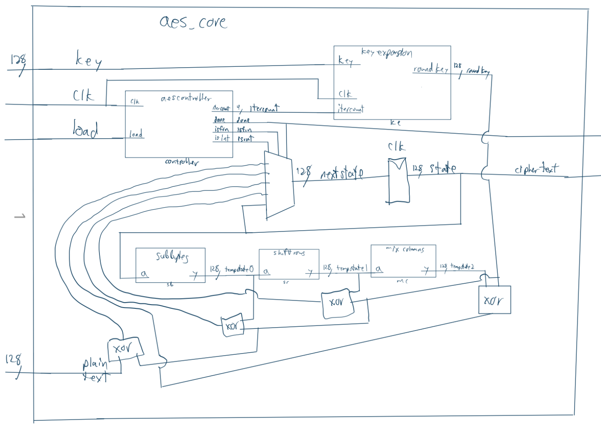
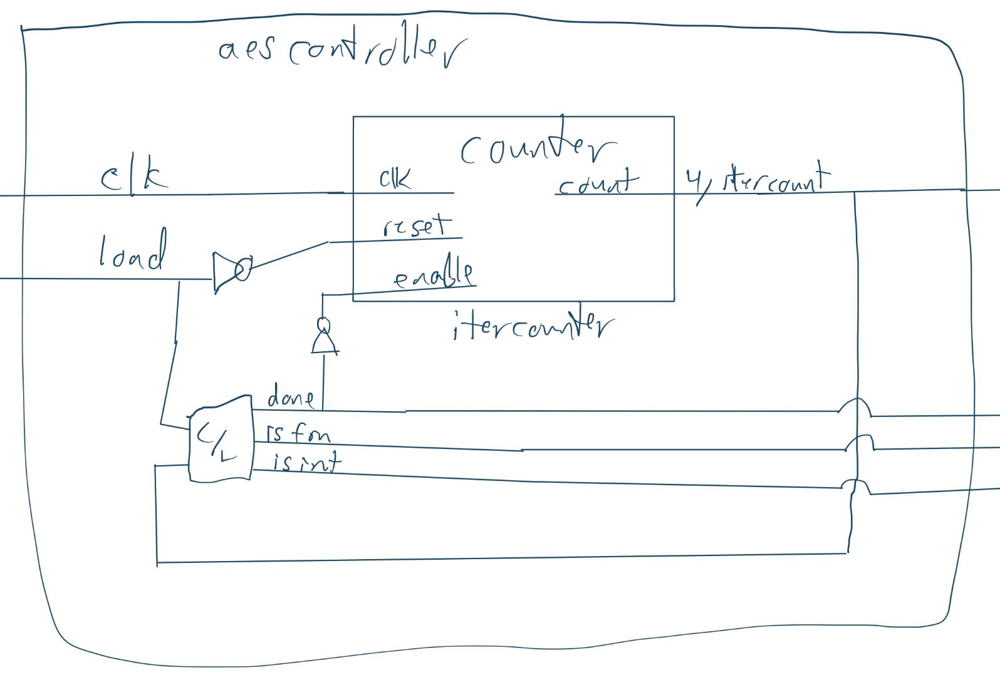
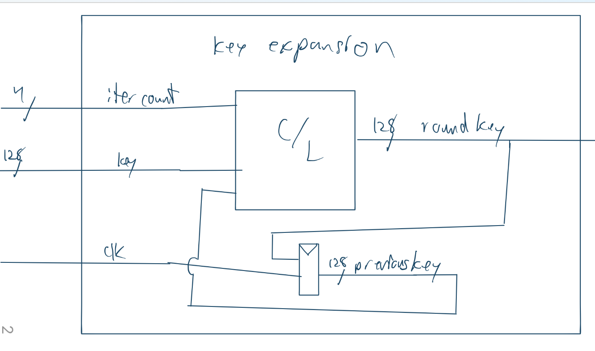
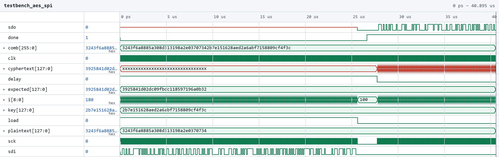
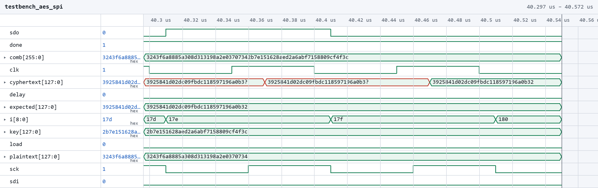
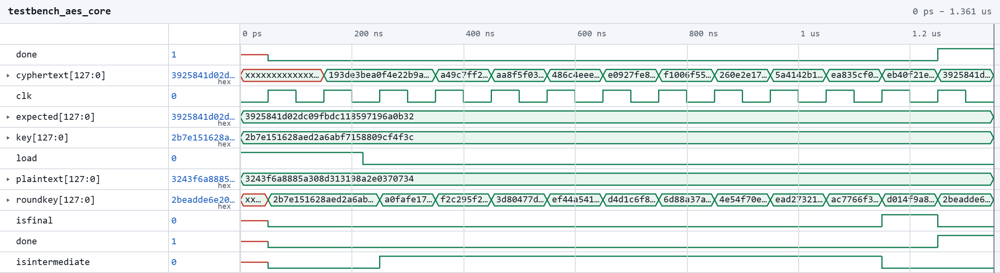
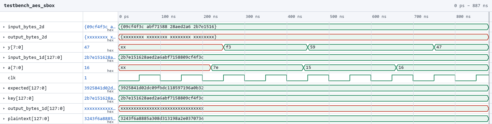

## Introduction
In this lab, I implemented a 10 round 128bit AES cipher on an Upduino 3.1 FPGA.

## Design and Testing Methodology
To reduce the amount LUT's required to perform the cipher, only a single instance of each cipher step was implemented, and state/key data was routed through them using flops and multiplexers. Example plaintext, key, and cipher values from the [AES documentation](https://github.com/Jebeandiah/e155lab7/tree/main) were applied using a test bench to verify correctness of the cipher. The documentation also includes intermediate state and roundkey values which were helpful for ensuring the roundkey was being calculated correctly.

## Technical Documentation
The source code and all figures for the project can be found in the associated [Github repository](https://github.com/Jebeandiah/e155lab7/tree/main)

### Block Diagrams
::: {.callout-note collapse="true"}
## Expand to see diagram

:::

## Results and Discussion

::: {.callout-note collapse="true"}
## Expand to see waveforms

:::

The design met all intended design objectives for profficiency. 

### Reflection
This lab took about 15 hours. Most of my time was spent fixing timing issues.

### AI Prototype Summary

Prompt 1: 

::: {.callout-note collapse="true"}
## Expand to see prompt:
"Write SystemVerilog HDL to implement the KeyExpansion logic described in the FIPS-197 uploaded document. The module should be purely combinational, using the previous key and current round number to calculate the next key. Assume other required modules (SubWord and RotWord) are already implemented."
:::

Model: "gemini flash 3.1"

::: {.callout-note collapse="true"}
## Expand to see AI output:

// Module: key_expansion_step
// Purely combinational logic to generate the next round key from the previous round key
// Supports AES-128 (Nk=4), AES-192 (Nk=6), and AES-256 (Nk=8) via parameters.

module key_expansion_step #(
    parameter int NK = 4  // Number of 32-bit words in key (4 for AES-128, 6 for AES-192, 8 for AES-256)
) (
    input  logic [31:0]           key_in  [0:NK-1], // Previous round key / key state
    input  logic [3:0]            round,           // Current round number (1 to Nr)
    output logic [31:0]           key_out [0:NK-1]  // Next round key / key state
);

    // Round Constant Lookup Table (Rcon[1..10])
    function automatic logic [31:0] get_rcon(input logic [3:0] r);
        case (r)
            4'd1:  get_rcon = 32'h01_00_00_00;
            4'd2:  get_rcon = 32'h02_00_00_00;
            4'd3:  get_rcon = 32'h04_00_00_00;
            4'd4:  get_rcon = 32'h08_00_00_00;
            4'd5:  get_rcon = 32'h10_00_00_00;
            4'd6:  get_rcon = 32'h20_00_00_00;
            4'd7:  get_rcon = 32'h40_00_00_00;
            4'd8:  get_rcon = 32'h80_00_00_00;
            4'd9:  get_rcon = 32'h1b_00_00_00;
            4'd10: get_rcon = 32'h36_00_00_00;
            default: get_rcon = 32'h00_00_00_00;
        endcase
    endfunction

    // Intermediate word declarations
    logic [31:0] rot_out;
    logic [31:0] sub_rot_out;
    logic [31:0] sub_temp_out;
    logic [31:0] temp [0:NK-1];

    // Instantiate RotWord module for the word coming from key_in[NK-1]
    RotWord u_rotword (
        .in  (key_in[NK-1]),
        .out (rot_out)
    );

    // Instantiate SubWord module following RotWord
    SubWord u_subword_rot (
        .in  (rot_out),
        .out (sub_rot_out)
    );

    // Instantiate SubWord for AES-256 extra substitution step at index i % 8 == 4
    generate
        if (NK > 6) begin : g_aes256_subword
            SubWord u_subword_temp (
                .in  (key_in[3]),
                .out (sub_temp_out)
            );
        end else begin : g_no_extra_subword
            assign sub_temp_out = 32'h0;
        end
    endgenerate

    // Key Generation Logic
    always_comb begin
        for (int i = 0; i < NK; i++) begin
            if (i == 0) begin
                // w[i] = w[i-Nk] ^ SubWord(RotWord(w[i-1])) ^ Rcon
                temp[0] = key_in[0] ^ sub_rot_out ^ get_rcon(round);
            end else if (NK > 6 && i == 4) begin
                // Special case for AES-256: w[i] = w[i-Nk] ^ SubWord(w[i-1])
                temp[i] = key_in[4] ^ sub_temp_out;
            end else begin
                // Standard case: w[i] = w[i-Nk] ^ w[i-1]
                temp[i] = key_in[i] ^ temp[i-1];
            end
        end
    end

    assign key_out = temp;

endmodule

:::

It works, but is much different than my code. It makes use of "for" loops and "generate" statements so that it can accommadate different AES word counts and rounds.   

Prompt 2:

::: {.callout-note collapse="true"}
## Expand to see prompt:
"Write SystemVerilog HDL to implement the following logic:
i = 0
while i < Nk do
    w[i] <- key[4*i..4*i+3]
    i <- i+1
end while
while i <= 4 * Nr + 3 do
    temp <- w[i-1]
    if i mod Nk = 0 then
        temp <- module1(module2(temp)) (+) Rcon[i/Nk]
    else if Nk > 6 and i mod Nk = 4 then
        temp <- module1(temp)
    end if
    w[i] <- w[i-Nk] (+) temp
    i <- i + 1
end while
return w
Assume module1 and module2 are existing modules that can be instantiated. (+) refers to XOR. Unwrap the loop in the provided pseudo code so it uses the previous iterations output to generate the new iteration.
Do not use any existing knowledge of the AES specifications in your answer."
:::

::: {.callout-note collapse="true"}
## Expand to see AI output:
// Module: key_expansion_step
// Purely combinational logic to generate the next round key from the previous round key
// Supports AES-128 (Nk=4), AES-192 (Nk=6), and AES-256 (Nk=8) via parameters.

module key_expansion_step #(
    parameter int NK = 4  // Number of 32-bit words in key (4 for AES-128, 6 for AES-192, 8 for AES-256)
) (
    input  logic [31:0]           key_in  [0:NK-1], // Previous round key / key state
    input  logic [3:0]            round,           // Current round number (1 to Nr)
    output logic [31:0]           key_out [0:NK-1]  // Next round key / key state
);

    // Round Constant Lookup Table (Rcon[1..10])
    function automatic logic [31:0] get_rcon(input logic [3:0] r);
        case (r)
            4'd1:  get_rcon = 32'h01_00_00_00;
            4'd2:  get_rcon = 32'h02_00_00_00;
            4'd3:  get_rcon = 32'h04_00_00_00;
            4'd4:  get_rcon = 32'h08_00_00_00;
            4'd5:  get_rcon = 32'h10_00_00_00;
            4'd6:  get_rcon = 32'h20_00_00_00;
            4'd7:  get_rcon = 32'h40_00_00_00;
            4'd8:  get_rcon = 32'h80_00_00_00;
            4'd9:  get_rcon = 32'h1b_00_00_00;
            4'd10: get_rcon = 32'h36_00_00_00;
            default: get_rcon = 32'h00_00_00_00;
        endcase
    endfunction

    // Intermediate word declarations
    logic [31:0] rot_out;
    logic [31:0] sub_rot_out;
    logic [31:0] sub_temp_out;
    logic [31:0] temp [0:NK-1];

    // Instantiate RotWord module for the word coming from key_in[NK-1]
    RotWord u_rotword (
        .in  (key_in[NK-1]),
        .out (rot_out)
    );

    // Instantiate SubWord module following RotWord
    SubWord u_subword_rot (
        .in  (rot_out),
        .out (sub_rot_out)
    );

    // Instantiate SubWord for AES-256 extra substitution step at index i % 8 == 4
    generate
        if (NK > 6) begin : g_aes256_subword
            SubWord u_subword_temp (
                .in  (key_in[3]),
                .out (sub_temp_out)
            );
        end else begin : g_no_extra_subword
            assign sub_temp_out = 32'h0;
        end
    endgenerate

    // Key Generation Logic
    always_comb begin
        for (int i = 0; i < NK; i++) begin
            if (i == 0) begin
                // w[i] = w[i-Nk] ^ SubWord(RotWord(w[i-1])) ^ Rcon
                temp[0] = key_in[0] ^ sub_rot_out ^ get_rcon(round);
            end else if (NK > 6 && i == 4) begin
                // Special case for AES-256: w[i] = w[i-Nk] ^ SubWord(w[i-1])
                temp[i] = key_in[4] ^ sub_temp_out;
            end else begin
                // Standard case: w[i] = w[i-Nk] ^ w[i-1]
                temp[i] = key_in[i] ^ temp[i-1];
            end
        end
    end

    assign key_out = temp;

endmodule
:::

This code also works and is very similar to the previous code. I don't think asking it to not use existing knowledge really does anything if you want it to ignore things it was trained on.

